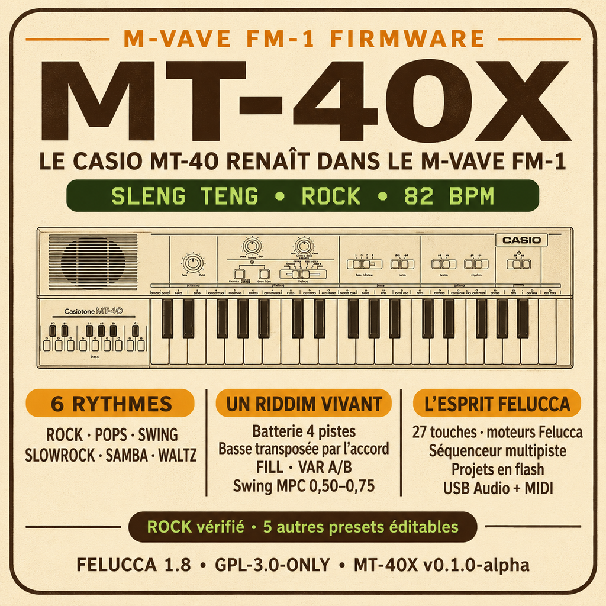
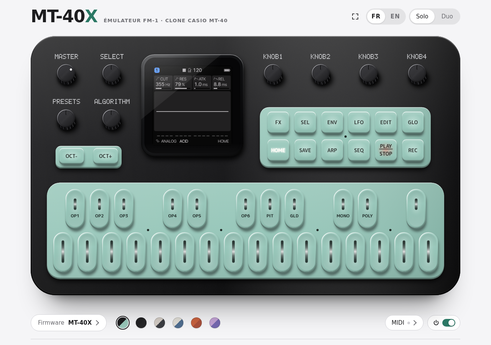

<div align="center">



# MT-40X

**Le Casio MT-40 de 1981 renaît dans le M-VAVE FM-1.**
Les six rythmes d'accompagnement d'origine — dont le **ROCK** de Hiroko Okuda,
le pattern qui a engendré le **Sleng Teng riddim** en 1985 — avec batterie,
basse transposée par les accords, bouton FILL et variation A/B.

[](LICENSE)
[](https://thefirmwarehub.com/)
[](docs/FELUCCA_UPSTREAM.md)
[](CHANGELOG.md)
[](docs/MT-40X_dossier_technique.pdf)
[](https://altessproduction.github.io/MT-4OX/)

**Soumission The Firmware Hub : identifiant `FM-1_23456`** — voir [docs/SUBMISSION.md](docs/SUBMISSION.md).

</div>

---

## Qu'est-ce que MT-40X ?

En 1981, Casio sort le MT-40, un clavier d'accompagnement bon marché. Un de ses
six presets de batterie programmés par Hiroko Okuda — « ROCK » — va changer
l'histoire de la musique : en janvier 1985, Wayne Smith enregistre *Under Mi
Sleng Teng* sur ce pattern au tempo 82, et le **digital dancehall** naît.

MT-40X reconstruit cette machine dans le firmware du FM-1 :

- **L'accompagnement complet** : batterie 4 pistes (kick, snare, hat fermée,
  hat ouverte), ligne de basse et nappes d'accord, en patterns de 2 mesures.
- **La basse se transpose toute seule** : jouez un accord à une touche (SCL >
  CHORD), le motif de basse suit la fondamentale — exactement le comportement du
  mini-clavier de basse du MT-40. C'est ainsi que l'on joue un riddim.
- **Le bouton FILL** : comme sur la vraie machine, un fill de batterie prend le
  relais jusqu'au prochain temps fort.
- **La variation A/B** et le **swing MPC** (0.5 à 0.75) intégrés au moteur.
- **Le clavier reste un FM-1** : les 27 touches jouent les moteurs de synthèse
  de Felucca (ANALOG, FM6, PHYS…), MT-40X ajoute l'accompagnement par-dessus.
- **Un vrai firmware complet** : séquenceur multipiste, projets en flash, éditeur
  web, USB audio + MIDI — tout l'héritage Felucca est conservé.

## Jouer dans le navigateur

Le dépôt embarque un émulateur complet du FM-1 : MT-40X y tourne **tel quel**,
sur la puce émulée, sans rien installer — à l'adresse
**<https://altessproduction.github.io/MT-4OX/>**. Allumez, PLAY, et le ROCK
joue. Le clavier de l'ordinateur fait piano (la rangée du milieu), les boutons
sont sur les chiffres, Espace fait PLAY, les flèches tournent les encodeurs.
« Ouvrir un .fwsc… » charge n'importe quel paquet à soi.



L'émulateur est celui de [FM-1+VA](https://github.com/Ninjathune-Human/Fm1)
(Ninjathune-Human), adapté pour ce dépôt — les seuls changements sont listés
dans [`web/EMULATOR_CHANGES.md`](web/EMULATOR_CHANGES.md) ; les firmwares émulés
tournent sur le cœur [fm1-emu](https://github.com/joakimeriksson/fm1-emu) de
Joakim Eriksson (MIT). L'éditeur web et l'installateur de Felucca restent
accessibles sous [`web/editor.html`](web/editor.html) et
[`web/index_pkg.html`](web/index_pkg.html).

## La page Riddims

Le bouton **« ♫ Riddims »** de la page (à côté du sélecteur de firmware) ouvre
les **38 riddims du « The Riddim Real Book (Tab) »** — de *African Beat* à
*Youth Man*, avec label, année, akas, accords et tempo du livre. Pour chacun :

- **Écouter** — une maquette Web Audio de la page : batterie et basse
  synthétisées, au tempo du livre, sans toucher au firmware ;
- **Séquenceur** — la basse est écrite dans la piste 3 et la batterie dans la
  piste 4 (moteur DRUM) du FM-1 émulé, par le protocole éditeur dans l'USB de
  la puce ; LEN 16 ou 32 pas, DIV 1/16, tempo de la fourchette du livre. Puis
  SEQ + PLAY sur le panneau ;
- **Motif de basse** — le MT-40X prend la ligne comme accompagnement, transposé
  par l'accord tenu au clavier, comme le mini-clavier basse du MT-40 (nécessite
  un firmware avec la banque riddim ; sans elle, la basse va au séquenceur et
  la page le dit).

Les données (`window.RIDDB`) sont générées depuis le PDF par
[`scripts/riddims_site.py`](scripts/riddims_site.py) — les notes de basse sont
celles des tablatures du livre, les batteries suivent le style de chaque
riddim (one drop, rockers, steppers, rocksteady, digital, dancehall).

## Les six rythmes

| # | Nom | Mesure | Tempo conseillé | État |
|---|-----------|--------|--------|------|
| 1 | **ROCK** (Sleng Teng) | 4/4, 2 mesures | 82 | Vérifié sur deux tablatures croisées, à caler à l'oreille |
| 2 | POPS | 4/4, 2 mesures | 100 | Brouillon éditable |
| 3 | SWING | 4/4, 2 mesures | 120 | Brouillon éditable |
| 4 | SLOWROCK | 4/4, 2 mesures | 70 | Brouillon éditable |
| 5 | SAMBA | 4/4, 2 mesures | 100 | Brouillon éditable |
| 6 | WALTZ | 3/4, 2 mesures | 90 | Brouillon éditable |

Les patterns vivent dans
[`data/mt40_patterns.json`](firmware/src/mt40/data/mt40_patterns.json) sous forme
éditable, puis sont générés en tables C par
[`tools/patterns_to_c.py`](firmware/src/mt40/tools/patterns_to_c.py).
La méthode de transcription (sources, vérifications, ajustements) est détaillée
au chapitre 9 du [dossier technique](docs/MT-40X_dossier_technique.pdf).

## Comment on en joue

| Action | Comment |
|---|---|
| Lancer / arrêter l'accompagnement | **PLAY / STOP** — il suit le transport et le tempo (G_BPM) du projet |
| Changer d'accord (et donc de basse) | Touche **SCL > CHORD**, une touche = un accord ; la fondamentale transpose la basse en direct |
| **FILL** | Couche **FX** (FX tenu), 5<sup>e</sup> touche noire |
| **VAR A/B** | Couche **FX**, 6<sup>e</sup> touche noire |
| Rythme suivant / précédent | Couche **FX**, 7<sup>e</sup> / 8<sup>e</sup> touche noire |
| Tempo | L'encodeur SELECT ou MENU > BPM (partagé avec le séquenceur) |
| Jouer par-dessus | Le clavier normal, sur n'importe quel moteur Felucca |

Le mix de l'accompagnement arrive dans le bus master avant les effets : la
couche FX (reverb, slicer, LPF…) s'applique aussi au MT-40X.

## Compiler et installer

Linux x86-64 natif (macOS : voir [BUILDING.md](BUILDING.md), via Docker) :

```sh
git clone --recurse-submodules https://github.com/altessproduction/MT-4OX.git
cd MT-4OX
pip3 install Pillow fonttools
tools/get_toolchain.sh                                   # la toolchain JieLi (~/.jieli)
git clone --depth 1 --branch AC79NN_SDK_V1.2.1_2023-12-13 \
    https://gitee.com/Jieli-Tech/fw-AC79_AIoT_SDK.git ~/fw-AC79_AIoT_SDK
./build.sh --release 0.1.0                               # -> build/release-0.1.0/
```

Le build produit le paquet `.fwsc` installable (application + loader de mise
à jour) dans `build/release-0.1.0/`, puis :

- **Installateur web** : ouvrez l'installateur de Felucca
  (<https://hugelton.github.io/Felucca/webapp/installer/>) en Chrome/Edge et
  chargez votre `.fwsc` local (copie locale du site + `localhost`), ou
- **Ligne de commande** : `python3 tools/fm1_install.py build/MT-40X-v0.1.2-FM-1_23456.fwsc`.

> **Avertissement** : installer un firmware non officiel se fait à vos risques.
> Si l'installation échoue, la restauration passe par
> [FM-1-transporter](https://github.com/kurogedelic/FM-1-transporter).
> Les FM-1 récents portent une flash UC25HQ80 : vérifiez avec
> `python3 tools/fm1_install.py --info` et utilisez un build Felucca >= 1.8.2-beta.

## Tests

```sh
# le moteur MT-40 hors matériel (aucune dépendance) :
cd firmware/src/mt40
gcc -O2 -Wall -Wextra -o mt40_host_test mt40_host_test.c mt40_engine.c \
    mt40_patterns.c mt40_voice.c mt40_drums.c -I. -lm
./mt40_host_test          # ALL CHECKS PASSED : ligne de basse, fills, rendu audio

# la suite complète de Felucca (rendus de référence, UI, stockage...) :
AC79_SDK=~/fw-AC79_AIoT_SDK sh tests/run_tests.sh
```

Le test hôte vérifie notamment la ligne de basse Sleng Teng
(`37 38 38 38 … 43 42`, avec l'approche chromatique -1 et la conclusion
quarte–tierce), les comptes de frappes, le FILL et un rendu audio borné.

## Structure du dépôt

```
MT-4OX/
├── build.sh                  # le build complet (toolchain JieLi, SDK AC79)
├── BUILDING.md               # le guide de compilation détaillé
├── fmhub.json                # la fiche The Firmware Hub (identifiant FM-1_23456)
├── firmware/
│   ├── src/
│   │   ├── mt40/             # LE CLONE : moteur, patterns, voix, drums, intégration
│   │   │   ├── mt40_types.h        # types partagés (patterns, timbres, événements)
│   │   │   ├── mt40_patterns.c     # les 6 rythmes + 22 timbres (généré du JSON)
│   │   │   ├── mt40_engine.c       # horloge, swing MPC, FILL, variation, transposition
│   │   │   ├── mt40_voice.c        # 9 voix pulse "stairwave" (PolyBLEP)
│   │   │   ├── mt40_drums.c        # 4 pistes de batterie (PCM ou synthèse)
│   │   │   ├── mt40_felucca.c      # la greffe dans le chemin audio de Felucca
│   │   │   └── mt40_host_test.c    # le test hors matériel
│   │   └── ...               # le tronc Felucca (seq, chord, voix, UI, stockage)
│   ├── engines/              # les moteurs (Felucca-Engines, MIT — vendorié)
│   └── bsp/                  # la couche matérielle FM-1 (felucca-bsp, MPL-2.0 — vendorié)
├── docs/
│   ├── MT-40X_dossier_technique.pdf   # le dossier de 24 pages (architecture, méthode, tutoriel)
│   ├── SUBMISSION.md         # la liste de contrôle The Firmware Hub
│   └── FELUCCA_UPSTREAM.md   # le README du projet d'origine
├── tests/                    # la suite hôte de Felucca (régression complète)
└── tools/                    # build, installateur, éditeur web
```

## Feuille de route

| Phase | Contenu | État |
|---|---|---|
| P1 | Moteur MT-40 (rythmes, basse, FILL, VAR), intégration audio, build réel | **ce dépôt (v0.1)** |
| P2 | Calage à l'oreille des 6 rythmes + pack de samples MT-40 (flash) | en cours |
| P3 | Page écran dédiée (grille 32 pas, sélection rythme, LED du pas courant) | à venir |
| P4 | Séquenceur 8 pistes façon MT-40X étendu | à venir |
| P5 | Horloge MIDI in/out, synchronisation externe, publication Hub | à venir |

## Licences et crédits

- **MT-40X** (le dossier `firmware/src/mt40/` et ce fork) : **GPL-3.0-only**,
  comme Felucca. Voir [LICENSE](LICENSE) et [LICENSING.md](LICENSING.md).
- **[Felucca](https://github.com/hugelton/Felucca)** par Leo Kuroshita
  (@kurogedelic) et Hügelton Instruments : la base de tout ce travail — moteur,
  séquenceur, accords, UI, build. Merci.
- **[Felucca-Engines](https://github.com/hugelton/Felucca-Engines)** (MIT) et
  **[felucca-bsp](https://github.com/hugelton/felucca-bsp)** (MPL-2.0) : vendoriés
  dans `firmware/engines/` et `firmware/bsp/`, textes conservés dans `LICENSES/`.
- **Casio MT-40** : le pattern ROCK est attribué à Hiroko Okuda (Casio, 1981) ;
  le Sleng Teng à Wayne Smith, Noel Davey et King Jammy (1985). Casio n'a jamais
  demandé mieux que d'être crédité — c'est fait ici et dans les en-têtes du code.
- Les trois fichiers du SDK JieLi embarqués dans le paquet (`uboot.boot`,
  `cfg_tool.bin`, `eq_cfg_hw.bin`) sont Apache-2.0 : leurs textes voyagent avec
  chaque release (`LICENSES/Apache-2.0.txt`).

<div align="center">
<sub>« Under mi sleng teng » — 82 BPM, pour toujours.</sub>
</div>
